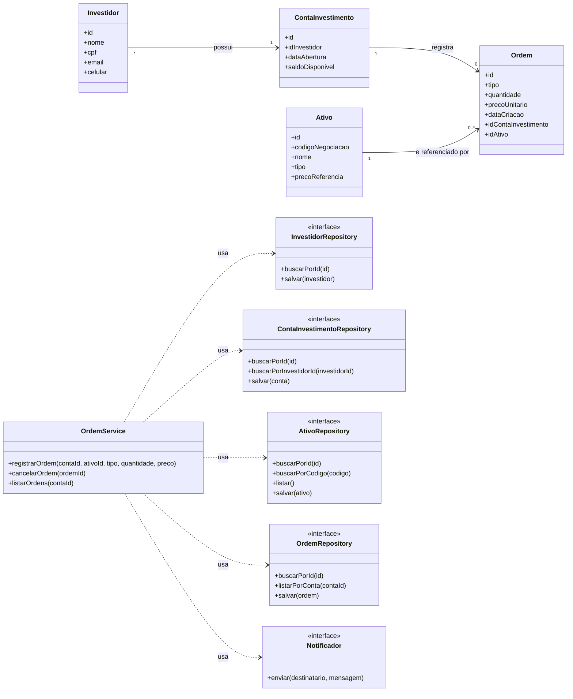

# Modelagem — Projeto 1

**Aluno(a):** Vitório Gomes de Freitas
**Domínio:** Simulador de Home Broker — Sistema de Negociação de Ativos Financeiros

## 1. O domínio

O investidor possui uma conta de investimento, na qual mantém o saldo disponível para realizar operações financeiras. Por meio do sistema, ele pode consultar ativos financeiros, como ações, ETFs e fundos imobiliários, e registrar ordens de compra e venda. Cada ordem está associada a um ativo e contém informações como tipo de operação, quantidade, preço e status. O sistema permite acompanhar as ordens registradas e controlar os recursos disponíveis para as negociações.

## 2. Entidades

| Entidade | Atributos | Relacionamentos |
| --- | --- | --- |
| Investidor | id, nome, cpf, email, celular | possui uma conta de investimentos |
| ContaInvestimento | id, idInvestidor, dataAbertura, saldoDisponível | regitra varias ordens |
| Ativo | id, codigoNegociacao, nome, tipo, precoReferencia  | é referenciada por várias ordens  |
| Ordem | id, tipo, quantidade, precoUnitario, dataCriacao, idContaInvestimento, idAtivo | referencia um ativo |

## 3. Diagrama de classes

## 4. Responsabilidades

| Classe | Papel | Único motivo para mudar |
| --- | --- | --- |
| `Investidor`, `ContaInvestimento`, `Ativo`, `Ordem` | Entidades | As regras e os atributos do próprio objeto (ex.: validação da quantidade de uma ordem) |
| `OrdemService` | Regra de negócio | O processo de registrar, cancelar e consultar ordens de negociação                     |
| `InvestidorRepository`, `ContaInvestimentoRepository`, `AtivoRepository`, `OrdemRepository` | Acesso aos dados | A forma de consultar e persistir os dados (ex.: memória, SQLite ou PostgreSQL) |
| `Notificador` | Comunicação | O canal de aviso como WhatsApp e e-mail. |

## 5. Onde apliquei SRP e DIP

- **SRP:** nenhuma entidade salva a si mesma nem envia e-mail. Guardar é papel dos
  repositories; avisar é papel do Notificador; o processo fica no OrdemService.
- **DIP:** o OrdemService depende dos contratos dos repositories e do Notificador,
  recebidos pelo construtor. Ele não sabe se os dados estão em memória ou em um banco.

## 6. Fora do escopo (YAGNI)

Login, cálculos de imposto, taxa de corretagem, relatórios, histórico de preços, integração para operações financeiras, compra e venda de ativos além de ações, ETFs, FIIs não entram no Projeto 1.